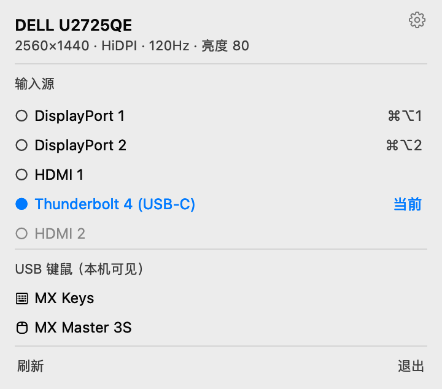
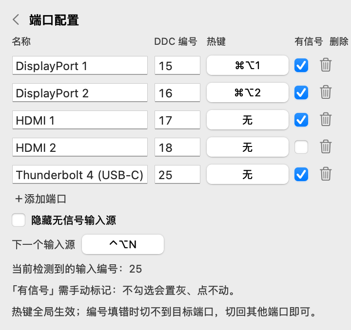

# dell-kvm-flash

一个极简的 macOS 菜单栏工具，用来切换 Dell 显示器的输入源（内置 KVM），替代 Dell Display and Peripheral Manager（DDPM）的常驻后台。



- 无 Dock 图标，只占菜单栏一个小图标
- 点击弹出小面板：显示器信息、输入源切换、随 KVM 切换的 USB 设备
- 端口名称 / DDC 编号可在面板内配置；每个端口一个全局热键，另有「下一个输入源」热键（只有两个信号时就是来回切）
- 自己实现 DDC/CI（IOAVService 私有 I2C 通道），不依赖 `m1ddc` 之类的命令行工具，也没有后台服务

## 系统要求

- macOS 14 或更新
- Apple Silicon
- 显示器通过 USB-C / 雷雳连接（DDC 只对 `DCPAVServiceProxy` 里 `Location = External` 的那路生效）

## 测试环境

- macOS 27.2（26B123），Apple M6
- DELL U2725QE，USB-C / 雷雳连接，5120×2880 缩放至 2560×1440 @ 120Hz

其他 macOS 版本、Intel Mac、其他显示器型号未测试。端口编号、USB 枚举结果和热键注册都取决于系统与显示器固件，换环境后需要在配置页校准。

## 安装

下载 `DellKVMFlash-<版本>.zip`，解压后把 `DellKVMFlash.app` 拖进「应用程序」。

首次打开如果提示「无法验证开发者」，在 App 上右键 → 打开，或执行：

```bash
xattr -d com.apple.quarantine /Applications/DellKVMFlash.app
```

App 使用 ad-hoc 签名（没有开发者证书），所以升级后第一次打开也需要同样操作。

## 构建

```bash
./scripts/build-app.sh     # 产物 .build/DellKVMFlash.app（自动打开）
./scripts/release.sh       # 产物 dist/DellKVMFlash-<版本>.zip
```

调试参数：`--show` 启动即展开面板，`--settings` 启动即打开端口配置，`--selftest` 打印 DDC/USB/配置/热键自检结果后退出，`--render out.png [--settings] [--dark] [--sample-usb] [--sample-config] [--sample-hidden]` 把面板离屏渲染成图片（无显示器也能看布局、出截图）。

## 使用



- 点击菜单栏的显示器图标打开面板
- 点击输入源立即切换；切换成功后面板自动关闭，失败则保留并显示原因
- 有信号的端口排在前面（组内保持配置顺序）；切换输入不会重排，只有改「有信号」时行才移动。● 与右侧「当前」标出当前输入，该行不可点击
- 未勾选「有信号」的端口置灰、点不动，排在列表末尾
- ⚙︎ 打开端口配置：可改名称、DDC 编号、有信号状态，为每个端口录入全局热键，`＋添加端口` / 🗑 增删端口；勾选「隐藏无信号输入源」后主面板只列有信号的端口（配置页始终列出全部）
- 「下一个输入源」是全局热键：按主面板顺序切到下一个有信号的端口并循环，只有两个时就是来回切
- 热键录制：点「无」→ 按下组合键（需带修饰键）；Delete 清除，Esc 取消
- 配置保存在 `~/Library/Application Support/DellKVMFlash/config.json`，可以直接手改；文件读不出来时会备份成 `config.json.broken` 再回退到默认端口

> DDC/CI 只能读到「当前输入」，读不出某个端口有没有信号，所以「有信号」是手动标记。切到没有信号的端口后，VCP 0x60 仍返回该端口的编号 —— 显示器只回答「选了哪个口」，不回答「这个口有没有画面」。

分辨率按 macOS 的逻辑分辨率显示，HiDPI 会标注出来（例如 5K 缩放到 2560×1440 时显示 `2560×1440 · HiDPI`）。

## 已知限制

- 无法自动检测端口是否有信号，只能手动标记（见上）；切到没信号的端口时屏幕会黑下去，切回来即可。
- 无法识别显示器 USB Hub 的芯片，USB 区只列本机看到的外接键鼠。
- 切换输入会让当前屏幕短暂黑屏，这是显示器行为，不是 bug。
- 只操作第一台外接显示器，多显示器环境下别的那台不受影响也不受控。
- 不同 Dell 型号的输入编号可能不同。面板 → 配置里可改每个端口的 DDC 编号（常见：15/16 = DP1/DP2，17/18 = HDMI1/HDMI2，27 = USB-C；U2725QE 的 USB-C 读作 25）。
- `IOAVService*` 是私有 API（运行时取符号，不链接）。系统大版本更新后如果改名，`DDC.isAvailable` 为 false，面板提示 DDC 不可用，端口切换被禁用。

## 参考

- [DESIGN.md](DESIGN.md)：模块、DDC 帧、面板结构、能做什么 / 不能做什么
- 配置文件：`~/Library/Application Support/DellKVMFlash/config.json`

## License

MIT
